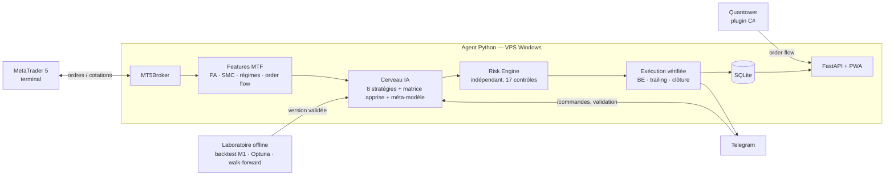

# Agent IA Forex — multi-stratégies, Quantower + MetaTrader 5

Agent de trading Forex qui analyse les marchés, identifie le régime (tendance, range, volatilité, liquidité),
choisit la stratégie la plus adaptée parmi 8, contrôle le risque via un moteur indépendant, exécute sur MT5
(mode manuel avec validation ou mode automatique), notifie tout sur Telegram et se pilote depuis une
application Web installable (PWA). L'apprentissage est **offline** et une nouvelle version n'est activée que
si elle passe des critères hors échantillon.

> ⚠️ Le trading comporte un risque de perte en capital. Aucun résultat passé, simulé ou backtesté ne garantit les
> résultats futurs. Utilisez d'abord un compte **démo**.

## Architecture



| Rôle | Composant | Dossier |
|---|---|---|
| Recherche (Étape 1) | 109 dépôts GitHub analysés, classés, composants testés | `research_lab/` |
| Analyse | Indicateurs, régimes, price action (BOS/CHOCH, S/R, chandeliers), SMC (FVG, OB, sweeps, BSL/SSL, premium/discount), order flow, MTF | `forex_agent/analysis/` |
| Stratégies | Trend Pullback, Volatility Breakout, Range Mean Reversion, SMC Liquidity Sweep, Order Flow Absorption, Momentum, Trend Breakout + Trailing, London Breakout | `forex_agent/strategies/` |
| Cerveau IA | Arbitrage multi-stratégies par régime et paire, espérance estimée, confluences/conflits, explication | `forex_agent/brain/` |
| Risque | Volume, risque %, R/R, pertes jour/semaine, drawdown, positions max, exposition globale et par devise, doublons, spread, slippage, news | `forex_agent/risk/engine.py` |
| Exécution | MT5 (vérification réelle de chaque ordre), broker papier (simulation) | `forex_agent/execution/` |
| Apprentissage | Backtest sur M1 réelles, Optuna imbriqué, walk-forward, méta-modèle, registre de versions, revue du journal | `forex_agent/learning/` |
| Interface | API REST + PWA (9 sections) | `forex_agent/api/`, `forex_agent/web/` |
| Notifications | Bot Telegram (signaux, exécutions, suivi, commandes sécurisées) | `forex_agent/notify/` |
| Données avancées | Bridge Quantower (delta, DOM, volume profile, déséquilibres, absorption) | `quantower_bridge/` |
| Déploiement | VPS Windows, démarrage auto, HTTPS | `deploy/windows/` |

## Démarrage rapide (simulation, Linux/Mac/Windows)

```bash
python -m venv .venv && .venv/bin/pip install -r requirements.txt
.venv/bin/python scripts/download_data.py          # données M1 réelles (HuggingFace), ~800 Mo
.venv/bin/python scripts/train.py                  # apprentissage offline complet -> models/, reports/learning/
FXA_BROKER=paper FXA_ALLOW_UNVALIDATED_MODEL=true FXA_API_PASSWORD=motdepasse .venv/bin/python scripts/run_agent.py
```

Ouvrir http://localhost:8000 (utilisateur `admin`). En mode `paper`, l'agent rejoue l'historique réel en
accéléré : tout est étiqueté **SIMULATION** et aucun ordre réel n'est passé.

## Production (compte démo MT5)

1. VPS **Windows** (MT5 et Quantower sont des applications Windows) : 4 vCPU, 8 Go RAM.
   Pas à pas pour Contabo : [`deploy/windows/GUIDE_CONTABO_MT5.md`](deploy/windows/GUIDE_CONTABO_MT5.md).
2. `deploy\windows\bootstrap.ps1` : Git, Python 3.12, MetaTrader 5, dépendances, assistant `.env`
   (`scripts/setup.py`), diagnostic + ordre de test (`scripts/mt5_check.py --test-order`), démarrage automatique.
3. Telegram : [`deploy/windows/GUIDE_TELEGRAM.md`](deploy/windows/GUIDE_TELEGRAM.md) — `scripts/setup.py telegram`
   détecte automatiquement votre chat_id.
4. (rappel) Activer « Algo Trading » dans MT5 et utiliser un compte démo.
5. HTTPS + application sur téléphone : `deploy\windows\enable_https.ps1` (adresse gratuite DuckDNS + certificat
   automatique Caddy, démarrage automatique).
6. Quantower : voir `quantower_bridge/README.md`.
7. Vérifier : `python scripts/mt5_check.py --test-order` (ordre 0.01 lot ouvert puis fermé, compte démo uniquement).

## Valider le modèle sur des données inédites

`python scripts/forward_test.py` (sur le VPS) rejoue la dernière version, **figée**, sur l'historique réel du broker
postérieur à toutes ses données d'entraînement (v3 : à partir du 2026-03-01). Si les critères sont remplis
(PF ≥ 1,1, espérance > 0, ≥ 30 trades, DD ≤ 15 %), la version devient active ; sinon elle reste réservée au démo.
Rapport : `reports/forward/<version>_<date>/REPORT.md`.

Démonstration complète en 17 étapes : [`docs/DEMO_CHECKLIST.md`](docs/DEMO_CHECKLIST.md).

## Modes et contrôle

- **Manuel** : chaque opportunité validée par le Risk Engine est envoyée sur Telegram (boutons ✅/❌) et dans
  l'application avec tous les paramètres. À la validation, le risque est recontrôlé au prix courant puis l'ordre
  est exécuté et vérifié dans MT5.
- **Automatique** : exécution sans validation individuelle si `mode=auto` **et** exécution auto = ON.
- **ON/OFF**, **pause**, **arrêt d'urgence** (clôture de toutes les positions de l'agent) : application, Telegram
  (`/auto off`, `/pause`, `/stop`) ou automatiquement si une limite de perte est atteinte.

Commandes Telegram : `/status /positions /performance /signals /pause /resume /mode [manual|auto] /auto [on|off] /stop /close <ticket>`.
Seuls les chat_id autorisés sont acceptés ; un PIN peut être exigé pour les commandes sensibles.

## Sécurité

Identifiants uniquement dans `.env` (jamais en base ni dans l'app) · mot de passe PBKDF2 + JWT · limitation des
tentatives de connexion · jeton dédié pour le bridge Quantower · compte MT5 **réel refusé** par défaut
(`FXA_ALLOW_LIVE_ACCOUNT`) · modèle non validé interdit sur compte réel · sauvegardes SQLite automatiques ·
journal complet des opérations · reconnexion automatique et alertes de déconnexion.

## Résultats mesurés (honnêtes)

Voir `reports/learning/v3/REPORT.md`. Sur 9 instruments (2023-01 → 2025-07, M1 réelles, spread + commission 7 $/lot) :

| Test | Trades | Rendement | Profit factor | Drawdown max |
|---|---|---|---|---|
| Agent complet hors échantillon (9 mois, jamais optimisé) | 184 | +2,3 % | 1,03 | 11,6 % |
| Walk-forward (7 fenêtres de 3 mois) | 576 | −6,8 % | 0,98 | — |

Aucune version n'atteint encore les critères d'activation (PF OOS ≥ 1,1, espérance > 0, ≥ 30 trades, DD ≤ 15 %).
Deux stratégies sont positives hors échantillon : Trend Breakout + Trailing (PF 1,55) et London Breakout (PF 1,32).
Par conception, l'agent **ne trade pas un compte réel** tant qu'aucune version n'est validée.

## Tests

```bash
.venv/bin/python -m pytest -q        # 35 tests : analyse, anti-look-ahead, risque, backtest, MT5 simulé, Telegram, API, flux complet
```
